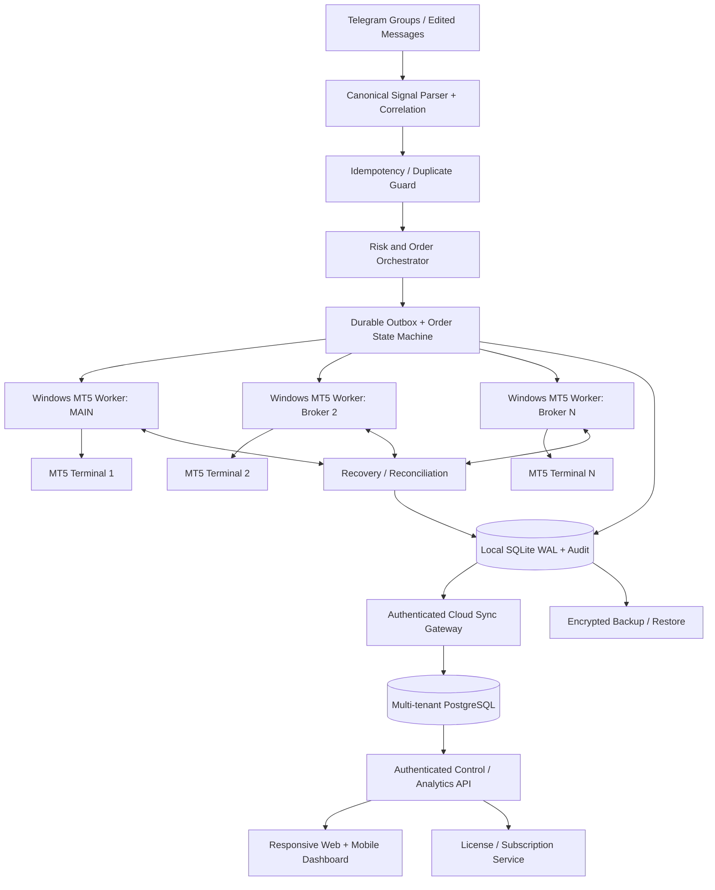

# EdgeQuant Sentinel V2 — Architecture & Implementation Plan

**Prepared:** 7 November 2026  
**Purpose:** Upgrade the existing Windows Telegram→MT5 client to a reliable, secure, sellable multi-client platform without removing the owner's order rules.  
**Status:** **DESIGN / IMPLEMENTATION PLAN ONLY**. This document does **not** claim that the ten features are coded or deployed. No live MT5 order was placed.

## 1. Actual source baseline inspected

Inspected package: `EdgeQuant_Duplicate_Entry_Protection_20261107.zip`.

| Existing source | Verified role / maturity |
|---|---|
| `edgequant_auto.py` | Current Python signal/execution engine; large monolithic module to refactor incrementally |
| `edgequant_desktop.py` | Current Windows desktop UI and settings; preserve existing behavior |
| `edgequant_parallel_mt5.py` | Multi-broker worker subprocess fan-out foundation |
| `edgequant_duplicate_guard.py` | Per-account normalized signal fingerprint and durable filesystem claims |
| `edgequant_signal_updates.py` | Telegram Sinhala/Singlish/English edits/replies parser and planner |
| `edgequant_vip_signal_edits.py`, `edgequant_vip_updates.py` | VIP format and trade management handling |
| `edgequant_web_agent.py` | Local read-only web dashboard foundation, **not** a production remote trading control platform |
| `edgequant_cloud.py`, `edgequant_remote_agent.py` | Cloud/relay integration foundations; evaluate and harden before production |
| `requirements.txt` and installer `.bat`/`.iss` | Current Windows installation/build paths |

Historical README files can contradict newer owner-rule documents. Treat `OWNER-LIMIT-2-LAYER-RULE-20261106.md`, `DUPLICATE-ENTRY-GUARD-20261107.md`, and `TELEGRAM-MULTILINGUAL-EDITS-20261106.md` as the currently inspected rule references; write one canonical, versioned configuration to eliminate conflicts.

## 2. Preserve these owner order invariants

- **New BUY/SELL LIMIT signal:** two logical layers per supplied entry, **per enabled MT5 account**, subject to risk/exposure/license and broker acceptance. Do **not** silently change to STOP/MARKET orders.
- **Gold price offset:** XAUUSD BUY `signal_entry + 0.99` and SELL `signal_entry - 0.90` (fixed price units, not dynamic spread; make configurable only via explicitly versioned owner settings). Other instruments: signal entry unless separately configured.
- **SL:** both layers take the same supplied signal SL. If absent, compute protective default **50 defined instrument pips** in the proper direction from adjusted entry.
- **TP:** layer 1 is **50 pips by default**, user-adjustable. Layer 2 retains signal TP, otherwise defaults to **150 pips**.
- **Duplicate identity:** account login+server, normalized symbol, direction, original signal entry, signal/fallback SL, layer-2 signal/fallback TP. Duplicate rule independent of Telegram chat/message IDs. Different message with the exact same tuple must not place another pair. Changed signal edits update mapped tickets, not place a second pair.
- **No client Bid/Ask price-distance skip** on owner LIMIT entry; submit request unchanged. MT5 may reject invalid order types/price/stops; record broker `retcode`, `comment`, and a reason. Do not pretend rejected requests are placed.
- **Multilingual edits:** when uniquely scoped by Telegram chat+message ID/reply and broker ticket mapping, update matching pending orders. Never move filled position entry. Do not guess an ambiguous target.
- **No AI Agent:** preserve removal of self-directed trading agent; these ten features are deterministic modules and owner-configurable automations.
- **Max open trades:** user-configurable caps; `0` represents no *application* cap, not unlimited account margin.
- Never claim that a received or submitted signal has been broker-confirmed until a valid broker ticket and confirmed result are recorded.

**Important:** `pip` sizing for XAUUSD differs across brokers/accounts. Add an explicit per-symbol `pip_size`/`tick_size` conversion table, tested with broker symbol metadata. Never infer '50 pips' from decimal places alone.

## 3. Reference deployment architecture

**Security/deployment boundary:** MT5 terminals, trading passwords (Windows DPAPI vault), Telegram authenticated session, and trade-execution worker stay on each customer's trusted Windows computer or dedicated Windows VPS. Cloud handles authentication, licensing, encrypted sync, and authorized commands; it does not receive raw MT5 password or Telegram session file. Trading must not depend on the mobile browser being open. Every broker has its own terminal path, process, account identity, and bounded work queue. Fan-out is not an atomic multi-broker transaction.

**Suggested technology:** Windows local service: Python 3.12, existing MetaTrader5 integration, SQLite WAL, subprocess worker isolation, supervised local background service; desktop remains existing Tkinter for V2 migration. Cloud: FastAPI (or equivalent typed API), PostgreSQL, hosted websocket/SSE transport, Redis only if queue/scale justifies it. Mobile: React/TypeScript + Tailwind PWA consuming a secure API. Licensing service: signed entitlements + audited device activation. S3-compatible encrypted object backups, keys separate from backups.

## 4. Ten feature specifications and acceptance criteria

### F01 — Smart Risk Manager
**Modules:** `risk/policy.py`, `risk/position_size.py`, `risk/exposure.py`, `risk/portfolio_state.py`.  
Before submission, compute per-account max daily loss, drawdown, margin sufficiency, total and symbol exposure, lot step/min/max, concurrent open+pending limits and correlated exposure. Calculate estimated stop-out loss with broker-specific `order_calc_profit`, after resolving proper price/tick/pip sizing. Stop new trades with `RISK_BLOCKED` and a precise reason; never silently resize user TP/SL. Configurable fixed lot or risk-based lot mode. Emergency stop must still allow cancel/close and recovery operations.  
**Accept:** configured caps apply independently per broker, demo test under margin exhaustion, risk audit and loss reset by broker day/timezone.

### F02 — MT5 Order Recovery & Reconciliation
**Modules:** `orders/state_machine.py`, `orders/outbox.py`, `mt5/reconciler.py`.  
Persist intended order and unique key **before** `order_send`. Transitions include `NEW`, `RISK_BLOCKED`, `DUPLICATE`, `QUEUED`, `SENDING`, `CONFIRMED_PENDING`, `FILLED`, `PART_FILLED`, `CANCELLED`, `EXPIRED`, `BROKER_REJECTED`, `UNKNOWN_RECONCILE`, `CLOSED`. Reconcile with `orders_get`, `positions_get`, `history_orders_get`, and `history_deals_get`, scoped to account+server, magic/comment and tickets. For timeout/restart, inspect broker first; never blindly resend an uncertain submission. Human confirmation required for genuine uncertain state, without an always-on manual-review gate for ordinary signals.  
**Accept:** kill process during submission, restart, confirm no duplicate order; reconcile filled and cancelled orders; detect a ticket already present at MT5.

### F03 — Advanced Telegram Commands
**Modules:** `telegram/events.py`, `telegram/parser_multilingual.py`, `telegram/correlation.py`, `telegram/command_policy.py`.  
Handle `NewMessage`, `MessageEdited`, replies and reconnected catch-up. Commands: modify entry, modify SL/TP, cancel matching pending orders, move SL to breakeven, close half by supported volume step, close matched position, 'no more buys' as provider-scoped directional hold, and explicit hold/resume. Build typed `SignalCommand` and enforce chat+message/reply ID correlation; if only a price is mentioned, demand unique candidate. Command precedence: cancel/risk-off beats later entry instructions. No inferred cancel/close from vague chat. Log original text, parsed fields, confidence, and targeted tickets.  
**Accept:** Sinhala/Singlish/English golden test corpus and adversarial ambiguous-message tests; updates never leak across chats or accounts.

### F04 — Multi-Broker Execution
**Modules:** extend `edgequant_parallel_mt5.py` into `mt5/worker.py`, `mt5/manager.py`, `mt5/symbol_map.py`.  
One isolated Windows subprocess per enabled account; verify `terminal64.exe`, exact login and server before processing. Per-account durable queue, credentials from DPAPI, `XAUUSD` suffix mapping and tick-size precision, broker retcode and actual tickets. Never fall back to MAIN when extra broker fails. Add worker heartbeat, bounded restart and circuit-breaker policy.  
**Accept:** two demo terminals with different symbol names, one rejected/one accepted, correct independent tickets and no cross-account modifications. Detect hedging vs netting account behavior before two-layer commitments.

### F05 — Trade Analytics
**Modules:** `analytics/ingest.py`, `analytics/metrics.py`, `analytics/api.py`.  
Ingest broker-confirmed fills/deals, including commissions/swaps/fees; never count a pending request as P&L. Broker, client, symbol, channel, date, layer, win/loss, RR, profit factor, expectancy, drawdown, daily return, duplicate rate and rejection reason charts. Preserve source message→signal→layer→broker ticket lineage. Adjust USC cent accounts and convert to display currency without changing source amounts.  
**Accept:** backfilled historical deals reconcile with MT5 totals; avoid double-counting partial closes, fees and shared netting positions.

### F06 — Signal Expiry
**Modules:** `orders/expiry.py`.  
Optional per-channel/per-symbol expiry in elapsed minutes or explicit Telegram timestamp. Expire **only unfilled pending orders**, scoped by account, signal and layer. Do not close filled positions. Race-safe `TRADE_ACTION_REMOVE` and broker-reconciled status. If broker disallows cancel, show `EXPIRY_CANCEL_FAILED`. Consider weekends/market closure policies.  
**Accept:** expiry while disconnected, while filled, and while cancellation races with execution; no wrong-ticket cancel.

### F07 — Smart BE & Partial TP
**Modules:** `positions/be_manager.py`, `positions/partial_close.py`.  
Per-layer independent target. Optionally after Layer 1 TP fill, update Layer 2 stop to entry ± user-configurable true price buffer (default disabled until specified). Preserve already-more-protective SL. Optional partial close percentage of an open position; honor minimum volume/step and broker hedging/netting rules. Distinguish '50 pips' as price distance vs profit. MT5 `TRADE_ACTION_SLTP` / deal close requests only after ticket/mode validation.  
**Accept:** BE not moved backwards, retry only after reconciliation, account isolation, no cross-layer stop modification.

### F08 — Mobile Dashboard
**Modules:** `cloud/api`, `web/src`, `edgequant_desktop` optional link.  
Mobile-first PWA: overview, broker connectivity, 2-layer signals, trade list, pending/filled/rejected states, analytics, alert centre, safe settings, license status. Initial release **read-only**; later optional signed owner-authorized commands for pause/resume, cancel pending, close position, with secure confirmation and full audit. No direct MT5 connection from iPhone/Android and no local passwords in the browser.  
**Accept:** user only sees their own brokers; mobile/browser disconnect does not interrupt Windows engine; unauthorized API calls denied.

### F09 — Client License System
**Modules:** `licensing/device_identity.py`, `licensing/entitlement.py`, `cloud/licenses`.  
Plans: Trial/Basic/Pro/Business; permitted devices, brokers, expiry and seat count. Signed license assertions, server-verifiable entitlements, device activation/revocation and offline grace policy. Keep license checks separate from trade/order risk logic. On expiry, block **new signal submissions**, but allow monitoring, reconciliation and safe close/cancel/manage actions (avoid stranding open positions). License keys never grant access to other users' accounts. Protect the API by tenant-scoped authorization and rotation/revocation.  
**Accept:** expired/offline/revoked/device-limit cases; never halt safe management of already open orders.

### F10 — Auto Backup & Recovery
**Modules:** `backup/snapshot.py`, `backup/restore.py`, `backup/retention.py`.  
Versioned, encrypted, checksummed backups of config, signal-to-ticket mappings, SQLite DB, claims, provider settings, installed-state metadata and non-secret logs. Telegram `.session` and DPAPI credentials are excluded from cloud uploads by default; re-authenticate separately. Local scheduled snapshots + optional encrypted offsite backup. Restore to staging folder, schema migration, and **reconcile with live MT5 before enabling submissions**.  
**Accept:** restore on clean machine, rollback test, checksum mismatch rejection, no duplicate placements after recovery.

## 5. Persistent data model (initial)

| Table | Principal fields / unique constraints |
|---|---|
| `tenants`, `users`, `devices`, `licenses` | `tenant_id`, `user_id`, `device_id`, license/entitlements; unique activated device per license |
| `brokers` | `tenant_id`, `account_login`, `server`, `terminal_path`, `symbol_map`, enabled; **do not store plaintext password** |
| `signal_messages` | `telegram_chat_id`, `message_id`, `reply_to_id`, edited_at, content_hash, raw_text reference |
| `signals` | `signal_id`, source message, normalized symbol, direction, original entry range, original SL/TP, current revision |
| `signal_revisions` | immutable revision records, effective fields, source event, author, timestamp |
| `signal_entries` | one row per supplied original price, normalized account-scoped duplicate fingerprint |
| `order_intents` | tenant/account/signal/entry/layer, adjusted entry, SL/TP, risk snapshot, idempotency key; unique `(account_id,signal_entry_id,layer,revision_action)` |
| `broker_orders` | broker ticket, retcode, state, account, broker symbol, magic, attempts, timestamps |
| `position_links`, `deals` | broker position/deal IDs, layer attribution, actual volume/price/P&L/fees |
| `commands`, `outbox_events` | unique command digest, explicit action, target tickets, acknowledgments |
| `risk_snapshots`, `audit_events` | immutable before/after, broker outcome, actor/source, timestamps |
| `backup_manifests` | snapshot version, checksum, encryption metadata and restore status |

**Migration requirement:** import existing `%LOCALAPPDATA%\EdgeQuant\duplicate_signal_claims_v1\` receipts and journal mappings into the new DB. Keep the old receipt mechanism read-only/fenced until complete reconciliation; otherwise upgrades could re-place old signals. For every account, unique idempotency keys must be enforced centrally in the local database and order worker, not just UI memory.

## 6. API boundary (proposed, not yet implemented)

- `GET /v2/me/overview` — user's account and engine status, latency and counts
- `GET /v2/brokers` — tenant-scoped brokers and redacted connection states
- `GET /v2/signals`, `GET /v2/orders`, `GET /v2/positions` — paged confirmed state
- `GET /v2/analytics?account_id=...&range=...` — aggregated broker-confirmed metrics
- `GET /v2/risk` and `PUT /v2/risk` — validated, permission-scoped settings
- `POST /v2/commands` — signed, nonce-protected command intent with unique idempotency key; never execute from HTTP request handler directly
- `GET /v2/commands/{id}` — accepted/rejected/confirmed/unknown outcome; never assume HTTP 200 means MT5 fill
- `POST /v2/devices/activate`, `GET /v2/license` — entitlement checks
- `GET /v2/health`, `GET /v2/events` — heartbeat and read-only live stream

Apply auth, per-tenant object authorization, TLS, rate limiting, audit, replay protection, role distinctions (owner vs viewer vs support) and explicit confirmation for destructive remote commands. Reject command requests for brokers owned by other tenants.

## 7. Delivery order with gates (no promised timeline)

| Stage | Build tasks | Required release gate |
|---|---|---|
| **0: Baseline hardening** | Freeze current owner rules as versioned tests; installer and Windows environment; compare legacy duplicate receipts vs MT5; secure config backups | Current Windows installer, demo connection, and regression suite baseline verified |
| **1: Core reliability** | Durable local SQLite/outbox, MT5 reconcilers, account/ticket identity, worker health, migration | Crash/timeout/restart causes zero unexpected duplicates; confirmed tickets match broker |
| **2: Trading controls** | Risk Manager, signal expiry, BE/partial TP, account/currency/tick-size normalization | Margin/stop/volume/hedging/netting demo tests; only intended tickets changed |
| **3: Telegram & multi-broker** | Multilingual command corpus, correlations, edit revisions, subprocess isolation | Mixed-language edit/reply/cancel tests; two-broker independent lifecycle |
| **4: Analytics & backups** | Verified deal ingestion, dashboards, backups, restores, migration | Broker totals match; restore without duplicate resubmission |
| **5: Cloud/mobile** | Tenant auth, secure sync, mobile read-only PWA, controlled remote actions | Tenant isolation tests, mobile offline behavior, no secrets exposed |
| **6: Licensing & release** | Signed device entitlements, renewals, activation, installer signing, client documentation | Expired license management safety, clean Windows install/upgrade, demo burn-in |

## 8. Example end-to-end order lifecycle

1. Telegram `GOLD BUY 4000 SL 3950 TP 4100` appears; collect chat/message IDs and hash.
2. Parser normalizes symbol `XAUUSD`, direction `BUY`, original entry `4000` and identifies action `PLACE`.
3. Per-MT5-account duplicate key is reserved durably. If matching entry/SL/TP already handled, state is `DUPLICATE` and no fresh placement occurs.
4. Risk engine checks lot, protective stop distance, limits, margin and license ability to open **new** orders. On block, persist reason rather than pretending broker submission occurred.
5. Create two `BUY_LIMIT` intents at **4000.99**. Both SL **3950**; L1 TP = configured 50-pip distance, L2 TP **4100**, respecting specified and broker-confirmed pip model.
6. The broker worker `order_send` request records broker retcode and confirmed ticket if successful. If rejected, show `BROKER_REJECTED`; if unknown, reconcile before retrying.
7. Later Telegram reply `entry eka 4050ta ganna SL eka 4000ta tiyanna` matches original message; if both orders are still pending, modify both broker tickets using retained `+0.99` offset, both SL = 4000, rebase L1 TP on the new adjusted entry, L2 TP retained 4100.
8. A filled position cannot have its entry changed; only permitted SL/TP changes are attempted. BE, expiry and analytics act from broker-confirmed states.
9. Client dashboard streams accepted and rejected statuses, no direct browser→MT5 order sending.

## 9. Quality / release checklist

- **Parser:** >100 curated Sinhala/Singlish/English signal, reply, edit and ambiguous command fixtures; source attribution and revisions.
- **Duplicate/recovery:** same content different message ID/group; concurrent workers; process kill; filesystem/database failure; timeouts; rejected LIMIT orders; restart. Never automatically resend an unknown outcome.
- **Broker:** MAIN + 2 different demo brokers, different symbol suffixes, hedging & netting, min lot/tick, freeze/stops levels, market close, disconnected terminal.
- **Risk:** balance/equity changes, commission/spread, pending/open count, maximum exposure; no unintended limit bypass.
- **Security:** cross-tenant ID access attempts, replay of signed commands, session expiry, device revocation, DPAPI vault, backups/redaction, no tokens in logs.
- **UX/install:** Windows 11 upgrade and clean install, signed EXE/installer where possible, branded shortcut, process/DLL locks, safe installer rollback and startup health.
- **Performance:** sustained Telegram bursts, concurrent account fan-out, database busy WAL handling, web sync offline queue, retention/backup restoration.
- **Operations:** trace each signal from message through intent and MT5 ticket; user-visible error codes; export diagnostics without credentials.

## 10. Decisions to configure before production

| Decision | Proposed default |
|---|---|
| Order lot | Preserve current configured micro-lot; add optional risk-derived sizing; never silently change live amount |
| Risk stop | Configurable per broker with emergency pause; independent from owner LIMIT entry gate |
| Layer1 BE trigger | Off initially; user can enable after demo verification |
| Partial close | Off initially until volume/netting behavior is verified |
| Expiry | Off initially; per-channel / per-symbol opt-in |
| Mobile commands | Read-only first; pause/cancel/close only after signed command audit passes |
| Cloud | Optional; local core remains functional offline subject to license offline grace |
| Duplicate receipt | Permanent per account/fingerprint by default; only explicit audited reset after reconciliation |
| Broker rejects | Never mislabel as placed; no automatic STOP/MARKET fallback |
| Open-order cap | Keep user-configured existing setting, with margin/risk protections independent |

## 11. External implementation references

- Official MetaTrader5 Python interface (`order_send`, `orders_get`, `positions_get`, `history_orders_get`, `history_deals_get`, `order_check`, `order_calc_profit`): https://www.mql5.com/en/docs/python_metatrader5
- Telethon events (`NewMessage`, `MessageEdited`): https://docs.telethon.dev/en/stable/quick-references/events-reference.html
- OWASP API Security Top 10 (tenant authorization, authentication, sensitive APIs): https://owasp.org/projects/api-security-project

**Next implementation action:** Begin **Stage 0**. Make a clean branch/copy from the inspected latest source, capture signed rule fixtures and actual Windows/demo baseline results, then implement **Stage 1** reliable local outbox, migration and reconciliation before adding mobile trade controls or license enforcement.
